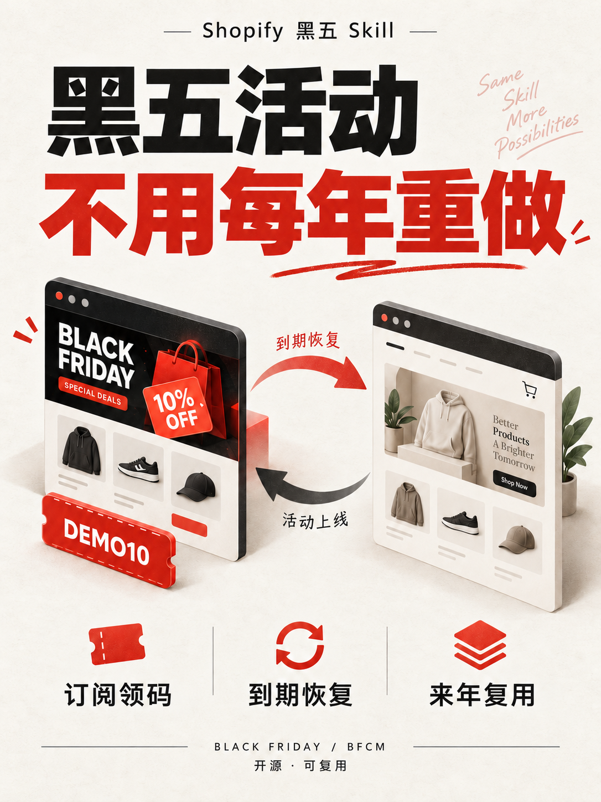

# Shopify Black Friday Skill

**Reusable Shopify BFCM campaigns: seasonal homepage, newsletter coupon popup, scheduled restoration and annual reuse.**

Shopify 黑五活动 Skill：准备活动首页、订阅领码弹窗与到期恢复方案，下一年更新配置即可复用。



> AI-generated concept illustration, not a screenshot of a merchant store. All codes and products shown are fictional examples.

## What it does

- Prepares a separate local campaign theme from a compatible Shopify Online Store 2.0 theme.
- Adds a mobile-friendly homepage and an accessible newsletter dialog that reveals a code after confirmed Shopify form acceptance.
- Preserves original homepage and section groups, selecting them again outside the explicit campaign window.
- Provides local renewal scripts, a backend discount checklist, and a reusable agent workflow.

**Preparation is implemented; live Shopify discount creation and theme publishing are not automated by this package.** An agent with authorized Shopify access can perform those steps using the included checklist. “Restore” means switching back to preserved normal content, not reverting orders, subscribers, product edits or unrelated app state.

## Install as a Codex skill

```bash
git clone https://github.com/WOOK98/shopify-black-friday-skill.git
mkdir -p ~/.codex/skills
cp -R shopify-black-friday-skill ~/.codex/skills/shopify-black-friday-skill
```

Then ask your agent:

```text
Use $shopify-black-friday-skill to prepare my Shopify Black Friday campaign.
Create a preview, preserve the normal site, and wait for my launch instruction.
```

The workflow and assets can also be used with other agents that support `SKILL.md`; host-specific installation may differ.

## Local quick start

Requires Python 3.10+. No API token is needed for local preparation.

Copy `examples/campaign.json` to a **private directory outside this repository**, then set dates, code, percentage, product handles and existing popup section IDs. The example is disabled by default.

```bash
python3 scripts/prepare_campaign.py \
  --theme /path/to/private/theme-export \
  --output /path/to/private/prepared-theme \
  --config /path/to/private/campaign.json

python3 -m unittest discover -s tests -v
```

For the full development suite (Python tests plus Liquid lifecycle checks), install Node.js 20+ and run `npm ci --ignore-scripts && npm test`. Node is not needed for local theme preparation.

Set `enabled: true` only when preparing an authorized scheduled release. An enabled campaign still renders normally before the start and after the last active second. Dates require explicit UTC offsets.

For annual reuse:

```bash
python3 scripts/renew_campaign.py \
  --theme /path/to/private/prepared-theme \
  --config /path/to/private/next-year.json
```

Update the backend discount separately. Confirm that the retained theme still matches the current store before reusing an old export.

## Compatibility and limits

| Area | Included behavior |
| --- | --- |
| Theme | Dawn-like OS 2.0 layouts with exactly one `header-group`, `footer-group` and `content_for_layout` |
| Homepage | Activity appears only on the index route during the enabled window |
| Welcome popup | Suppresses explicitly selected footer section IDs in the campaign group only |
| App popups | External app embeds require separate configuration; not automatically disabled |
| Discounts | Draft plan for percentage, dates and no combinations; no Admin API mutation |
| Subscription | Confirmed form acceptance; double opt-in and strict subscriber eligibility require backend configuration |
| Expiry | Server-rendered state on requests; open tabs refresh at the boundary when running/online |
| Localization | English fallback added to storefront locale files; translate for non-English stores |
| Products | Up to three selected products; example ships with no merchant products or images |

Full guide: [implementation](references/implementation.md) · [launch and restore](references/launch-and-restore.md) · [privacy](docs/privacy.md) · [naming rationale](docs/naming.md).

## Preview and promotional material

[Xiaohongshu post](marketing/xiaohongshu/post.md) · [card source](marketing/xiaohongshu/cards.md) · [image prompts](marketing/xiaohongshu/image-prompts.md)

These materials introduce the skill, not a real merchant promotion. No post is automatically published and no customer email is sent.

## License

[MIT](LICENSE). This is an independent community project, not an official Shopify product.
